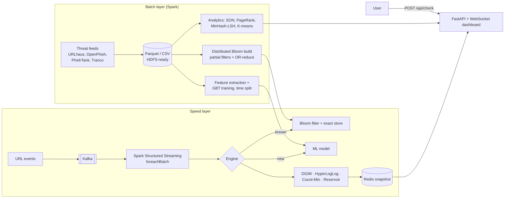

<div align="center">

# 🛡️ PhishStream

### Real-time phishing detection and threat analytics on a streaming big data pipeline

**Kafka → Spark Structured Streaming → Bloom filter + ML → streaming sketches → Redis → FastAPI dashboard**


</div>

---

## Why this exists

Phishing links (fake KYC, bank, bill and parcel messages) are created faster than any blacklist can list them. A useful detector has to:

1. **Instantly recognise known threats** across lakhs of listed URLs, in tiny memory.
2. **Catch brand-new phishing** that no list has seen yet.
3. **Spot campaigns as they start**, over an endless stream of events.
4. **Explain the threat landscape**: who is targeted, which infrastructure is shared, which lures work.

PhishStream does all four, and measures every component against an exact baseline.

## Headline results

> Measured on the bundled **synthetic** dataset (143,794 URLs, 49,595 phishing in 3,371 planted campaigns). Synthetic data makes results optimistic; see [Data](#data) for running on real feeds.

| | Result |
|---|---|
| **New-phishing detection** (time-based split, future campaigns only) | Gradient boosting: **99.3% precision, 97.9% recall**, PR-AUC 0.992 |
| Blacklist alone on the same future URLs | **0.1% recall**, which is why the ML stage exists |
| Spark MLlib GBT on the same split | PR-AUC 0.990, precision 99.3%, recall 96.9% |
| Streaming engine (Bloom + ML + 5 sketches per event) | **~9,400 events/sec per core**, p95 1.3 ms |
| Bloom filter | 41,769 URLs in **73 KB** (28× smaller than a Python set), 0.101% observed FP vs 0.1% target, 0 false negatives |
| Distributed Bloom build on Spark | **Bit-for-bit identical** to the single-machine build |
| HyperLogLog | ~2% error at 1M distinct hosts in **4 KB** (exact set: 89 MB) |
| Count-Min Sketch | 100% top-20 heavy-hitter recall, 0.2% mean error, 53 KB for 1M events |
| DGIM (N = 10,000) | 19 buckets (152 bytes), mean error 10%, max 33% (bound 50%) |
| MinHash + LSH | 3,301 campaigns from 34,750 hosts, **99.6% of pairwise comparisons skipped**, 78% cluster purity vs planted labels |
| PageRank on the infrastructure graph | Recovered **7 of 8** planted bulletproof hosting networks in the top 8 |
| PCY vs Apriori | 298 vs 2,701 candidate pairs counted, identical 129 frequent pairs (SON on Spark agrees) |

## Architecture



Executors do the per-event work (Bloom lookup + model scoring, with the model loaded once per executor). The driver applies the **order-dependent** DGIM update and merges the other sketches, then publishes a snapshot to Redis.

## Big data concepts covered

| Concept | Implementation |
|---|---|
| **Distributed storage / batch processing** | Spark jobs over CSV/Parquet (HDFS paths work unchanged) |
| **MapReduce pattern** | Distributed Bloom build: map = partial filter per partition, reduce = bitwise OR (`spark_jobs/build_bloom_spark.py`) |
| **Stream processing** | Kafka + Spark Structured Streaming micro-batches (`spark_jobs/streaming_job.py`) |
| **Bloom filter** | Optimal m/k, Kirsch-Mitzenmacher double hashing, union, two-stage check (`sketches/bloom.py`) |
| **DGIM** | Sliding-window count for campaign alerts (`sketches/dgim.py`) |
| **Flajolet-Martin → HyperLogLog** | Distinct hosts and distinct malicious hosts (`sketches/hyperloglog.py`) |
| **Count-Min Sketch** | Heavy hitters: most-targeted brands and hosts (`sketches/countmin.py`) |
| **Reservoir sampling** | Uniform sample of flagged events (`sketches/reservoir.py`) |
| **Shingling, MinHash, LSH** | Look-alike domain campaigns, banding S-curve (`analytics/campaigns.py`) |
| **Frequent itemsets** | Apriori, PCY, SON (Spark), association rules with lift (`analytics/frequent_itemsets.py`) |
| **Link analysis** | PageRank with taxation on the domain–IP–network graph, local and Spark RDD |
| **Clustering** | K-means scam families, k chosen by silhouette (`analytics/clustering.py`) |
| **Big data ML** | scikit-learn HistGradientBoosting and Spark MLlib GBT, time-based split, permutation importance |

## Screenshots

<table>
<tr>
<td width="50%"><br><sub><b>Check a link</b>: verdict, model score and plain-language reasons</sub></td>
<td width="50%"><br><sub><b>Model &amp; benchmarks</b>: blacklist vs ML on future URLs, confusion matrix, sketch accuracy</sub></td>
</tr>
<tr>
<td colspan="2"><br><sub><b>Insights</b>: findings, brands, TLDs, time patterns, lure rules, LSH campaigns, PageRank infrastructure, scam families</sub></td>
</tr>
</table>

## Quick start (local, no Docker)

```bash
git clone https://github.com/<your-username>/PhishStream.git
cd PhishStream
pip install -r requirements.txt

python -m phishstream.pipeline          # data -> Bloom filter -> model -> analytics (~1 min)
uvicorn phishstream.api.app:app --port 8000
# open http://127.0.0.1:8000
```

In local mode the API runs the engine in-process, fed by a simulator that replays held-out URLs. Use **Start a phishing campaign** on the Live tab to inject a burst and watch DGIM raise the alert.

### Spark jobs

```bash
pip install -r requirements-bigdata.txt          # adds pyspark, kafka-python, redis
python spark_jobs/build_bloom_spark.py           # distributed Bloom build + identity check
python spark_jobs/analytics_spark.py             # SON, RDD PageRank, MLlib GBT (or --only son|pagerank|mllib)

# Structured Streaming without Kafka (file source):
python -m phishstream.stream.producer --sink files --batches 20 --rate 100000
python spark_jobs/streaming_job.py --source files --seconds 60
```

### Full cluster mode (Kafka + Spark + Redis)

```bash
docker compose up --build
# open http://localhost:8000  (mode shows "cluster (Kafka + Spark)")
```

### Benchmarks and tests

```bash
python -m benchmarks.benchmark      # writes data/artifacts/benchmarks.json
pytest -q                           # 16 tests: sketches, analytics, API
```

## Data

| Mode | Command | Notes |
|---|---|---|
| **Synthetic** (default) | `python -m phishstream.pipeline` | Deterministic. Plants campaigns, bulletproof networks and time patterns, and stores the ground truth so LSH and PageRank can be **scored**. Includes hard cases (hacked sites, free hosting, news articles about scams, shorteners) and 0.5% label noise. |
| **Real feeds** | `python -m phishstream.ingest.real_feeds --resolve 20000` then `python -m phishstream.pipeline` | URLhaus (with timestamps), OpenPhish, optional PhishTank (`--phishtank-key`), Tranco top sites as safe URLs. `--resolve` adds IPs for PageRank. |

**Honest caveats**
- Findings on synthetic data validate the **methods**, not the real world. Re-run on real feeds before quoting threat statistics.
- Tranco lists bare domains, so realistic paths are added to safe URLs to stop the model from learning "has a path = phishing".
- Lexical models can be evaded by attackers who imitate clean URLs; production systems add page content, WHOIS and reputation signals.

## API

| Method | Path | Purpose |
|---|---|---|
| `POST` | `/api/check` | `{"url": "..."}` → verdict, score, Bloom result, reasons |
| `GET` | `/api/live` · `WS /ws/live` | Live snapshot: verdict counts, wave level, DGIM, HLL, Count-Min, reservoir |
| `POST` | `/api/burst` · `/api/sim` | Inject a campaign / change simulator rate (local mode) |
| `GET` | `/api/insights` | Analytics, model metrics, Spark results, benchmarks |
| `GET` | `/docs` | Interactive OpenAPI docs |

## Project structure

```
phishstream/
├── sketches/        bloom.py · dgim.py · hyperloglog.py · countmin.py · reservoir.py · minhash.py
├── features/        url_features.py      28 lexical features + human-readable reasons
├── ml/              train.py             time split, baselines, GBT, permutation importance
├── analytics/       descriptive · frequent_itemsets · pagerank · campaigns · clustering · insights
├── stream/          engine.py · simulator.py · producer.py
├── ingest/          synthetic.py · real_feeds.py
├── api/             app.py · static/index.html
└── pipeline.py      one-command build
spark_jobs/          build_bloom_spark.py · analytics_spark.py · streaming_job.py
benchmarks/          benchmark.py
tests/               16 tests
docker-compose.yml   Kafka (KRaft) · Redis · producer · Spark streaming · API
```

## Deploy (Render, free)

`render.yaml` is included. Create a **Web Service** from the repo, or set:
- Build: `pip install -r requirements.txt && python -m phishstream.pipeline`
- Start: `uvicorn phishstream.api.app:app --host 0.0.0.0 --port $PORT`
- Env: `PYTHON_VERSION=3.12.7`

The free plan runs the local-mode engine (no Kafka/Spark). Use `docker compose` for the full cluster.

<details>
<summary><b>Design decisions</b></summary>

- **Two-stage known-threat check.** The Bloom filter answers "definitely not" for almost every event; only a "maybe" touches the exact store, so false positives never reach users.
- **Time-based split, not random.** Random splits leak campaign siblings into training and inflate accuracy. Training on the past and testing on future campaigns mirrors deployment.
- **DGIM on the driver.** DGIM depends on event order, so it is updated in order on the driver; HLL and Count-Min are mergeable and could be built per partition.
- **Verify LSH candidates.** LSH proposes pairs; exact Jaccard plus a 72-hour co-occurrence window confirms them before union-find, which stops unrelated campaigns chaining together.
- **Stable hashing.** PCY uses CRC32, not Python's salted `hash()`, so results are reproducible across runs and executors.
</details>
