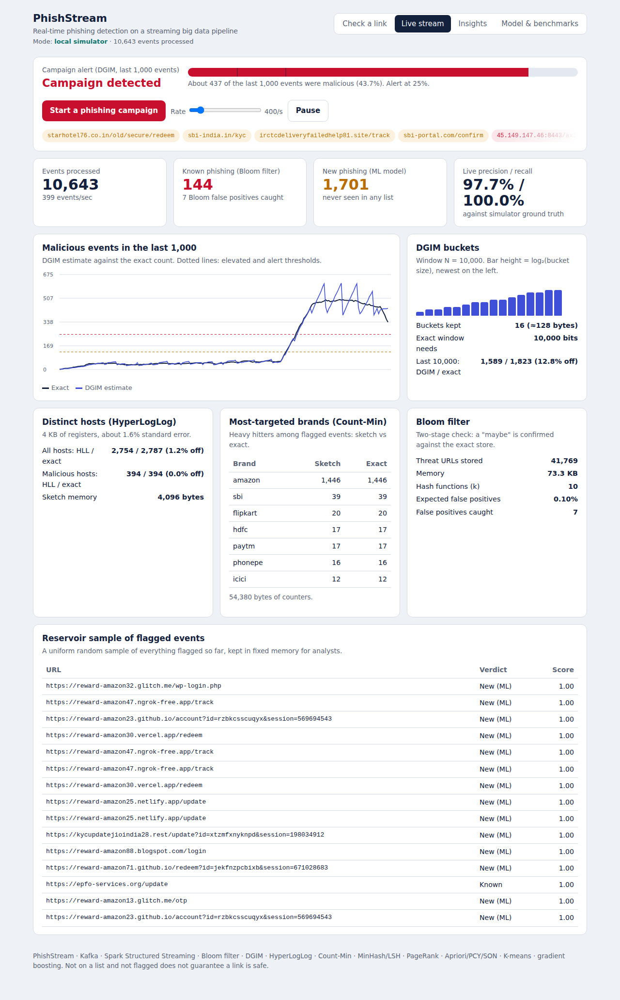
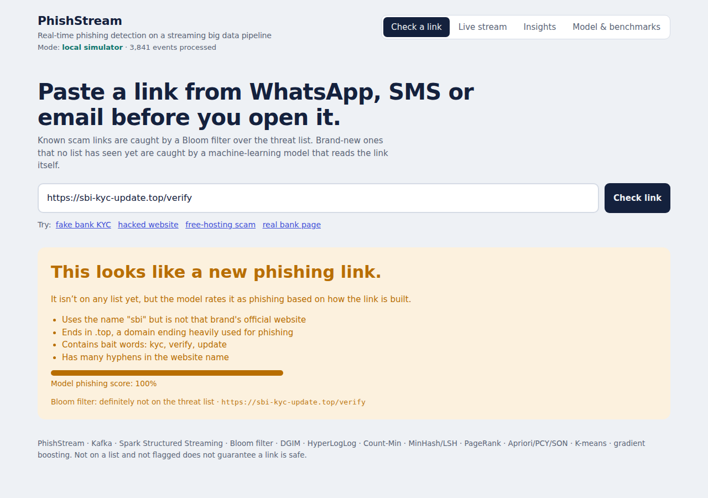
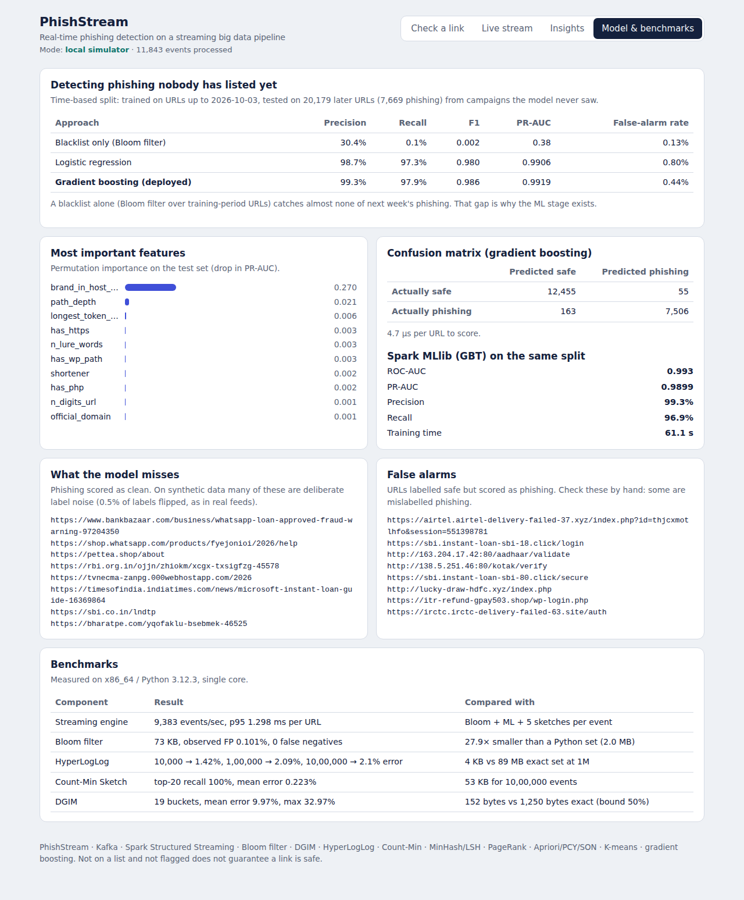
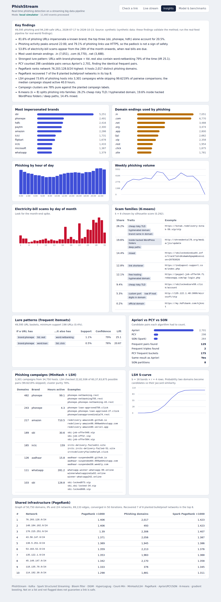

<div align="center">

# 🛡️ PhishStream

### Real-time phishing detection and threat analytics on a streaming big data pipeline

**Kafka → Spark Structured Streaming → Bloom filter + ML → streaming sketches → Redis → FastAPI**

[](https://phishstream.onrender.com)


**Built by [Vismaya Katkar](https://github.com/katkarvismaya19-web)**

<a href="https://phishstream.onrender.com"></a>

<sub>The live demo runs on Render's free plan: the first load after a quiet spell takes about 50 seconds.</sub>

</div>

---

## Table of contents

- [Overview](#overview)
- [Key results](#key-results)
- [Architecture](#architecture)
- [Big data concepts](#big-data-concepts)
- [Screenshots](#screenshots)
- [Getting started](#getting-started)
- [Data](#data)
- [API](#api)
- [Project structure](#project-structure)
- [Deployment](#deployment)
- [Design decisions](#design-decisions)
- [Limitations and roadmap](#limitations-and-roadmap)
- [Author](#author)

## Overview

Phishing links (fake KYC, banking, electricity-bill and parcel-delivery messages) are created faster than any blacklist can list them. A practical detector must:

1. **Recognise known threats instantly** across lakhs of listed URLs, using very little memory.
2. **Catch brand-new phishing** that no list has seen yet.
3. **Detect campaigns as they begin**, over an unbounded stream of events.
4. **Explain the threat landscape**: which brands are targeted, which infrastructure is shared, and which lures recur.

PhishStream addresses all four in a single pipeline, and benchmarks every component against an exact baseline.

## Key results

> Measured on the bundled **synthetic** dataset of 143,794 URLs (49,595 phishing across 3,371 planted campaigns). Synthetic data produces optimistic numbers; see [Data](#data) to run on real threat feeds.

| Component | Result |
|---|---|
| **Zero-day detection** (time-based split, future campaigns only) | Gradient boosting: **99.3% precision, 97.9% recall**, PR-AUC 0.992 |
| Blacklist alone on the same future URLs | **0.1% recall**, the gap the ML stage closes |
| Spark MLlib GBT (same split) | PR-AUC 0.990, precision 99.3%, recall 96.9% |
| Streaming engine (Bloom + ML + 5 sketches per event) | **~9,400 events/sec per core**, p95 latency 1.3 ms |
| Bloom filter | 41,769 URLs in **73 KB** (28× smaller than a Python set); 0.101% observed false positives against a 0.1% target; zero false negatives |
| Distributed Bloom build (Spark) | **Bit-for-bit identical** to the single-machine build |
| HyperLogLog | ~2% error at 1M distinct hosts in **4 KB** (exact set: 89 MB) |
| Count-Min Sketch | 100% top-20 heavy-hitter recall, 0.2% mean error, 53 KB for 1M events |
| DGIM (N = 10,000) | 19 buckets (152 bytes); mean error 10%, max 33% (theoretical bound 50%) |
| MinHash + LSH | 3,301 campaigns from 34,750 hosts; **99.6% of pairwise comparisons avoided**; 78% cluster purity |
| PageRank (infrastructure graph) | Recovered **7 of 8** planted bulletproof hosting networks in the top 8 |
| Frequent itemsets | PCY counted 298 candidate pairs vs 2,701 for Apriori, with identical results (129 pairs); SON on Spark agrees |

## Architecture


**How a micro-batch is processed.** Executors handle the per-event work (Bloom lookup and model scoring, with the model loaded once per executor). The driver applies the order-dependent DGIM update, merges the remaining sketches and publishes a snapshot to Redis, which the dashboard streams over WebSocket.

## Big data concepts

| Concept | Implementation |
|---|---|
| Distributed batch processing | Spark jobs over CSV/Parquet; HDFS paths work unchanged |
| MapReduce pattern | Distributed Bloom build: map = partial filter per partition, reduce = bitwise OR (`spark_jobs/build_bloom_spark.py`) |
| Stream processing | Kafka + Spark Structured Streaming micro-batches (`spark_jobs/streaming_job.py`) |
| Bloom filter | Optimal m and k, Kirsch-Mitzenmacher double hashing, union, two-stage check (`sketches/bloom.py`) |
| DGIM | Sliding-window count driving campaign alerts (`sketches/dgim.py`) |
| Flajolet-Martin / HyperLogLog | Distinct hosts and distinct malicious hosts (`sketches/hyperloglog.py`) |
| Count-Min Sketch | Heavy hitters: most-targeted brands and hosts (`sketches/countmin.py`) |
| Reservoir sampling | Uniform sample of flagged events (`sketches/reservoir.py`) |
| Shingling, MinHash, LSH | Look-alike domain campaigns with banding S-curve (`analytics/campaigns.py`) |
| Frequent itemsets | Apriori, PCY and SON (Spark), association rules with lift (`analytics/frequent_itemsets.py`) |
| Link analysis | PageRank with taxation on the domain–IP–network graph, local and Spark RDD |
| Clustering | K-means scam families, k selected by silhouette score (`analytics/clustering.py`) |
| Machine learning at scale | scikit-learn HistGradientBoosting and Spark MLlib GBT, time-based split, permutation importance |

## Screenshots

<table>
<tr>
<td width="50%"><br><sub><b>Check a link</b>: verdict, model score and plain-language reasons</sub></td>
<td width="50%"><br><sub><b>Model &amp; benchmarks</b>: blacklist vs ML on future URLs, confusion matrix, sketch accuracy</sub></td>
</tr>
<tr>
<td colspan="2"><br><sub><b>Insights</b>: findings, brands, TLDs, time patterns, lure rules, LSH campaigns, PageRank infrastructure, scam families</sub></td>
</tr>
</table>

## Getting started

### Prerequisites
- Python 3.12
- Java 17+ (only for the Spark jobs)
- Docker (only for full cluster mode)

### Local mode

```bash
git clone https://github.com/katkarvismaya19-web/PhishStream.git
cd PhishStream
pip install -r requirements.txt

python -m phishstream.pipeline          # data → Bloom filter → model → analytics (~1 min)
uvicorn phishstream.api.app:app --port 8000
```

Open http://127.0.0.1:8000. In local mode the engine runs in-process, fed by a simulator that replays held-out URLs. On the **Live stream** tab, click **Start a phishing campaign** to inject a burst and watch DGIM raise the alert.

### Spark jobs

```bash
pip install -r requirements-bigdata.txt          # adds pyspark, kafka-python, redis
python spark_jobs/build_bloom_spark.py           # distributed Bloom build + identity check
python spark_jobs/analytics_spark.py             # SON, RDD PageRank, MLlib GBT
                                                 # (or --only son | pagerank | mllib)

# Structured Streaming with a file source (no Kafka needed)
python -m phishstream.stream.producer --sink files --batches 20 --rate 100000
python spark_jobs/streaming_job.py --source files --seconds 60
```

### Cluster mode (Kafka + Spark + Redis)

```bash
docker compose up --build
```

Open http://localhost:8000. The header shows **cluster (Kafka + Spark)** when live statistics are coming from the streaming job.

### Benchmarks and tests

```bash
python -m benchmarks.benchmark      # writes data/artifacts/benchmarks.json
pytest -q                           # 16 tests: sketches, analytics, API
```

## Data

| Mode | Command | Notes |
|---|---|---|
| **Synthetic** (default) | `python -m phishstream.pipeline` | Deterministic. Plants campaigns, bulletproof networks and time patterns, and keeps the ground truth so LSH and PageRank can be **scored**. Includes hard cases (compromised sites, free hosting, news articles about scams, URL shorteners) and 0.5% label noise. |
| **Real feeds** | `python -m phishstream.ingest.real_feeds --resolve 20000`<br>then `python -m phishstream.pipeline` | URLhaus (timestamped), OpenPhish, optional PhishTank (`--phishtank-key`), and Tranco top sites as safe URLs. `--resolve` adds IP addresses for the infrastructure graph. |

**Caveats**
- Findings on synthetic data validate the **methods**, not real-world threat statistics.
- Tranco lists bare domains, so realistic paths are added to safe URLs to prevent the model from learning "has a path means phishing".
- Lexical models can be evaded by attackers who imitate clean URLs; production systems add page content, WHOIS and reputation signals.

## API

| Method | Endpoint | Description |
|---|---|---|
| `POST` | `/api/check` | `{"url": "..."}` → verdict, score, Bloom result and reasons |
| `GET` | `/api/live` | Live snapshot: verdicts, alert level, DGIM, HyperLogLog, Count-Min, reservoir |
| `WS` | `/ws/live` | Same snapshot pushed every second |
| `POST` | `/api/burst` | Inject a phishing campaign (local mode) |
| `POST` | `/api/sim` | Change simulator rate or pause it |
| `GET` | `/api/insights` | Analytics, model metrics, Spark results, benchmarks |
| `GET` | `/docs` | Interactive OpenAPI documentation |

Example:

```bash
curl -X POST https://phishstream.onrender.com/api/check \
  -H "Content-Type: application/json" \
  -d '{"url": "https://sbi-kyc-update.top/verify"}'
```

## Project structure

```
PhishStream/
├── phishstream/
│   ├── sketches/      bloom · dgim · hyperloglog · countmin · reservoir · minhash
│   ├── features/      url_features.py — 28 lexical features + human-readable reasons
│   ├── ml/            train.py — time split, baselines, gradient boosting, importance
│   ├── analytics/     descriptive · frequent_itemsets · pagerank · campaigns · clustering · insights
│   ├── stream/        engine.py · simulator.py · producer.py
│   ├── ingest/        synthetic.py · real_feeds.py
│   ├── api/           app.py · static/index.html
│   └── pipeline.py    one-command build
├── spark_jobs/        build_bloom_spark.py · analytics_spark.py · streaming_job.py
├── benchmarks/        benchmark.py
├── tests/             16 tests
├── docs/              screenshots, resume notes
├── docker-compose.yml Kafka (KRaft) · Redis · producer · Spark streaming · API
├── render.yaml        Render deployment
└── .github/workflows  CI
```

## Deployment

The live demo is hosted on Render using `render.yaml`:

| Setting | Value |
|---|---|
| Build | `pip install -r requirements.txt && python -m phishstream.pipeline` |
| Start | `uvicorn phishstream.api.app:app --host 0.0.0.0 --port $PORT` |
| Environment | `PYTHON_VERSION=3.12.7`, `SIM_RATE=300` |

The free plan runs the local-mode engine. Use `docker compose` for the full Kafka + Spark cluster.

## Design decisions

- **Two-stage known-threat check.** The Bloom filter answers "definitely not" for almost every event; only a "maybe" touches the exact store, so false positives never reach users.
- **Time-based split, not random.** Random splits leak sibling URLs from the same campaign into training and inflate accuracy. Training on the past and testing on future campaigns mirrors real deployment.
- **DGIM on the driver.** DGIM depends on event order, so it is updated in order on the driver. HyperLogLog and Count-Min are mergeable and can be built per partition.
- **Verified LSH candidates.** LSH proposes pairs; exact Jaccard similarity plus a 72-hour co-occurrence window confirms them before union-find, which prevents unrelated campaigns from chaining together.
- **Stable hashing.** PCY uses CRC32 rather than Python's salted `hash()`, so results are reproducible across runs and executors.

## Limitations and roadmap

- [ ] Validate all results on real threat feeds and publish the findings
- [ ] Page-content and WHOIS features for evasive URLs
- [ ] Counting Bloom filter to support removals
- [ ] Per-region campaign alerts
- [ ] Browser extension and WhatsApp bot front-ends
- [ ] Kubernetes deployment with autoscaling Spark executors

## Author

**Vismaya Katkar**

[](https://github.com/katkarvismaya19-web)

If you find this project useful, consider giving it a ⭐.

<div align="center">
<sub>Designed and built by Vismaya Katkar · PhishStream © 2026</sub>
</div>
